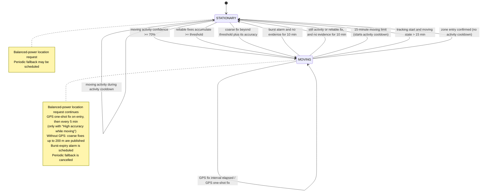
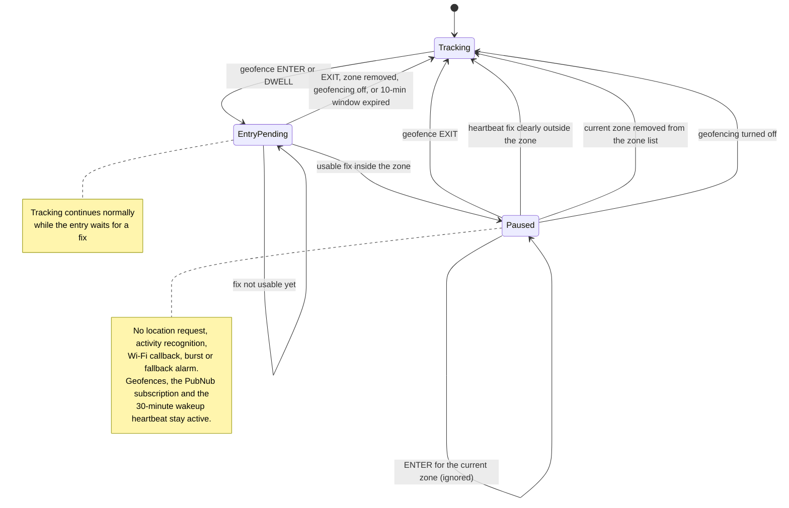

# Movement detection state diagram

The movement controller has two persisted states. Its inputs are the
continuous location updates, GPS and verification one-shot fixes, activity
recognition, Wi-Fi loss, and the burst-expiry alarm. The foreground service
does not change the state machine; it owns delivery of location callbacks while
the coordinator applies these transitions.

Zone pause and roaming pause are separate from the movement state: while either
is active no input reaches the state machine. A confirmed zone entry ends
`MOVING`; a roaming pause keeps the movement state as it was (see "Zone pause").

## Transition details

### `STATIONARY` to `MOVING`

The coordinator switches to `MOVING` when it receives one of these signals:

- Activity recognition reports walking, running, cycling, on foot, or in a
  vehicle with at least 70% confidence, outside the activity cooldown.
- Consecutive location fixes with accuracy of 50 m or better accumulate at
  least the configured movement distance (100 m by default). Segments shorter
  than 5 m are treated as jitter and not accumulated.
- A coarse fix (accuracy worse than 50 m) lies at least the configured
  movement distance plus both its own accuracy and the reference fix's
  accuracy away from the reference fix.

The reference fix is the last fix that moved the position: every reliable fix,
and a coarse fix only when it counts as movement (or when there is no
reference yet). Coarse fixes never accumulate distance. Requiring both
uncertainty circles to clear the threshold keeps coarse jitter around a
stationary device from switching into moving mode, while still detecting
travel when the balanced request only yields network fixes. Because a coarse
fix that proves travel becomes the reference, coarse fixes at the destination
are compared with the arrival position rather than the trip's start, so they
stop counting as movement and `MOVING` ends. A reliable fix that follows a
coarse reference only re-anchors the position; it does not accumulate distance,
so the coarse fix's error is not counted as travel. With an approximate-only
permission (about 2 km accuracy) moving mode starts only after a jump of
roughly 4 km plus the movement distance, or from activity recognition. Wi-Fi
loss triggers only a balanced one-shot verification fix; it no longer switches
state directly. The continuous scan defaults to a 2-minute interval with batched
delivery, similar to Home Assistant Companion's background cadence.

Entering `MOVING` clears the activity cooldown, schedules the burst-expiry
alarm, cancels the periodic fallback, and requests a GPS fix when one is due.

### GPS while `MOVING`

The continuous location request is balanced power accuracy in both states, so
GPS is never left running. When "High accuracy while moving" is enabled and
fine location is granted, the coordinator takes a GPS one-shot fix (30 s
timeout) on entering `MOVING` and then at most once per GPS fix interval
(5 minutes by default, configurable from 1 to 30 minutes in settings). The
interval also applies across `MOVING` sessions: re-entering `MOVING` within
the interval of the last GPS request (for example right after the 15-minute
limit) waits for the interval instead of taking a new fix. The check runs on
each continuous location callback, so it needs no alarm of its own; the
effective interval is the configured one rounded up to the next callback. A
GPS fix goes through the normal fix handling: it becomes the reference fix,
counts as movement evidence when it covers the movement distance, and is
published by the filter. A GPS request that returns nothing or fails is only
recorded; the next one follows after the interval.

Two other one-shot fixes also use GPS when the switch is on: the fix requested
when tracking starts, and the periodic fallback fix while `STATIONARY` (when
the fallback is enabled). Wi-Fi loss, zone confirmation and the heartbeat's
zone check always use balanced accuracy.

When the switch is off, or fine location is not granted, GPS is never used.
While `MOVING`, coarse fixes are then published with an accuracy cap of 200 m
(or the configured publish cap if larger), and only when the distance from the
last published position exceeds the fix's own accuracy, so coarse jitter is
not reported as movement. Approximate-only fixes are coarser than this cap and
are not published. In `STATIONARY` the normal 50 m publish cap applies either
way. With the switch on, coarse fixes are not published: the GPS fixes are the
reliable positions, so a trip where every GPS request fails publishes only
network fixes of 50 m or better.

### `MOVING` to `STATIONARY`

The coordinator returns to `STATIONARY` when no movement evidence has been
seen for the burst duration (10 minutes by default). This is checked when the
burst-expiry alarm fires, and also on each still activity and each reliable fix
that does not cover the movement distance. Coarse fixes never end `MOVING`;
the burst-expiry alarm does.

A moving state older than 15 minutes is also reset to stationary when tracking
starts (for example after a service or process restart), so moving mode (and
its GPS fixes) is never left active indefinitely.

During a running session, the same 15-minute limit applies even when movement
evidence keeps arriving. It is checked on each location callback, activity
update and burst-expiry alarm, and the burst-expiry alarm is scheduled for no
later than the limit. The reset starts a 15-minute activity cooldown in which
moving activity is ignored; a location fix (reliable or coarse) that proves
travel still resumes moving mode and clears the cooldown. The fixes in the
batch that triggers the reset are still evaluated and published, so a device
that is really travelling resumes moving mode immediately instead of going
dark for the cooldown. On a long trip the state therefore restarts about every
15 minutes.

## Zone pause

Inside a known zone tracking is paused entirely. Location requests, activity
recognition, the Wi-Fi callback, the burst and periodic alarms, and publishing
are stopped. Geofence monitoring, the PubNub subscription and the heartbeat
remain active: the heartbeat re-registers the never-expiring geofences so zone
exit survives process death and geofence loss. Geofences use a dwell delay and
an initial ENTER trigger, so a device booted inside a zone pauses without
waiting for a transition.

Arriving in a zone ends the trip: when an entry or zone switch is confirmed
while `MOVING`, the state switches to `STATIONARY` before tracking pauses.
Unlike the 15-minute limit this starts no activity cooldown, so moving activity
switches to `MOVING` again as soon as tracking resumes after leaving the zone.

### Zone entry confirmation

A geofence ENTER (or DWELL) does not pause tracking by itself; it starts a
pending entry that must be confirmed by a location fix. This keeps a coarse
fix from briefly pausing tracking for a zone the device is not really in.

A null triggering fix (the engine decided by other means), or one that is
merely stale, outside the radius, or too coarse to trust, still arms the entry.
A triggering fix coarser than the zone-aware cap is not silently discarded:
the geofence engine decided the device is inside the zone, so the entry is kept
pending and the coarse trigger is recorded in the arming diagnostics. The
bounded confirmation window is the backstop: it expires the entry if no usable
fix arrives.

The confirmation is background-capable and tries fixes in this order:

1. The geofence event's **triggering location**, confirmed immediately. This
   is the fix the geofence engine already used to decide the transition, so a
   usable fix pauses tracking without waiting for a background-frozen delay or
   a fresh one-shot.
2. If the triggering fix is not usable, a **one-shot** request after the entry
   hysteresis delay, allowed to answer with a recent cached fix.

A fix confirms the entry when it is not stale and its fix point is inside the
zone radius. Its accuracy is checked against a zone-aware cap — the normal
publish cap widened to the zone radius — so a coarse-but-plausible fix (for
example an indoor Wi-Fi fix) can confirm a large zone without waiting for
perfect GPS. On confirmation the entry fix is published and tracking pauses.

A single rejection does not drop the entry. A fix that is merely not usable
(stale, or outside the radius) leaves the entry pending, and each subsequent
location update re-evaluates it, so the entry is confirmed as soon as a usable
fix arrives. A missing zone clears it immediately. The pending entry is bounded
by a confirmation window (10 minutes): if no usable fix arrives within it, the
entry expires rather than lingering. The window is checked on each update and on
the heartbeat as a backstop. The pending entry also tracks the persisted zone
list: if a new zone list no longer contains the armed zone, the entry is dropped
immediately rather than lingering until the window expires.

### Zone switch

While a zone is current the coordinator is paused with no ongoing location
request, so the only fix it can act on is a geofence event's triggering
location. If the geofence engine then reports an ENTER (or DWELL) for a
*different* zone — which is the normal signal that the device really left the
current zone — the coordinator attempts a **zone switch** instead of (or in
addition to) arming a pending entry:

- The triggering fix must validate against the entered zone's zone-aware
  accuracy cap (same rules as entry confirmation),
- its fix point must sit inside the entered zone, and
- it must lie outside the current zone (guards against a coarse fix that is
  inside both).

When all three hold, the fix is published under the entered zone's zone-aware
cap (so the tracker sees the device leave the old zone and arrive in the new
one), the entered zone becomes current, and the pause persists — the device is
inside a zone either way, and a real EXIT for it resumes tracking as usual.

The switch is attempted once from the triggering fix and, if that fails, from
the pending entry's one-shot fallback. Ordinary location updates are not
delivered while paused, so they cannot confirm a switch. A stale pause (the
device is really elsewhere but the current zone was never exited) resolves
itself with the first usable fix that proves the device is in the other zone.
Every rejected switch attempt is recorded in the diagnostics. A null triggering
fix can confirm a switch only through the one-shot fallback, and an ENTER for
the zone that is already current changes nothing. An ENTER for another zone
within the geofence debounce (3 minutes by default) of the last zone
transition is ignored to suppress flapping; ENTERs while no zone is current
are not debounced, since the entry confirmation already guards them.

### Current zone check

A switch only helps when the device reaches another zone. Leaving a zone for a
place that is not a zone produces no ENTER, so a lost EXIT would otherwise keep
tracking paused indefinitely. On every heartbeat while a zone is current, the
coordinator requests one balanced fix (a cached fix up to 2 minutes old is
allowed) and treats the zone as exited when the fix is outside the radius by
more than its own accuracy (`distance - accuracy > radius`). The exit then
follows the normal zone exit path, including the departure publish. A fix
inside, or too uncertain to tell, keeps the pause. A current zone that no
longer exists in the zone list is exited as well.

A device paused in a zone has no location or activity requests that would
wake it, so the heartbeat is a wakeup alarm, and its broadcast stays open
(bounded at 45 seconds) until the check's fix arrives or fails. Otherwise the
check would wait in Doze for an unrelated wakeup, or the device would sleep
before the fix was delivered.

When a zone list update removes the current zone, tracking resumes immediately
instead of waiting for the next heartbeat. Turning geofencing off in settings
also resumes tracking at once: it clears the current zone and any pending
entry, removes the geofences and stops the zone subscription, and geofence
ENTER events still in flight are ignored.

### Zone exit

A geofence EXIT resumes tracking immediately (it is not debounced, so a
boundary-induced exit recovers promptly). The exit's triggering location — the
fix the geofence engine used to decide the device left the zone — is published
as a best-effort departure point, so Home Assistant sees the device move out of
the zone right away rather than waiting for the first post-exit fix. The
zone-aware accuracy cap applies, so a coarse fix still registers for a large
zone. A stale exit (the device is not currently in the zone) is ignored, and an
exit while a matching entry is still pending cancels that entry.

## Registration rule

Location and activity registrations are idempotent. A callback must process
its fixes without re-registering either provider. The location request is the
same in both movement states, so a state change never re-registers it. It is
only changed when the scan interval or the delivery mode (direct callback from
the foreground service or PendingIntent) changes, when a zone pause, roaming
pause or the background-collection setting removes and restores it, or when
registration health recovery is required.

If movement-state logic changes, update this diagram and its transition details
in the same change.
