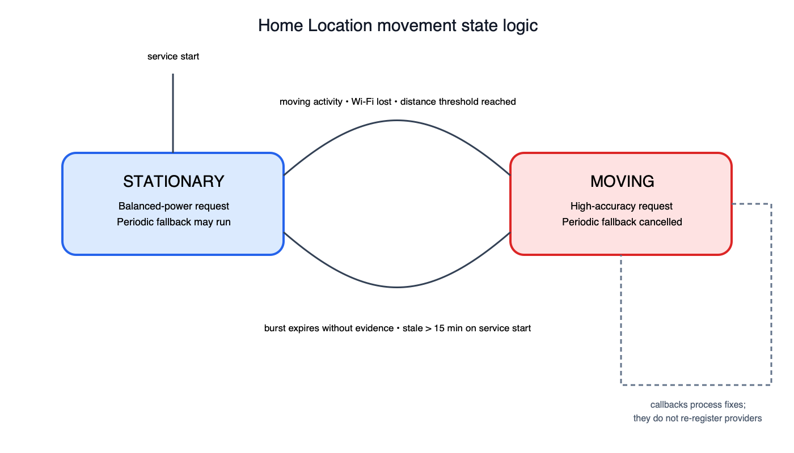
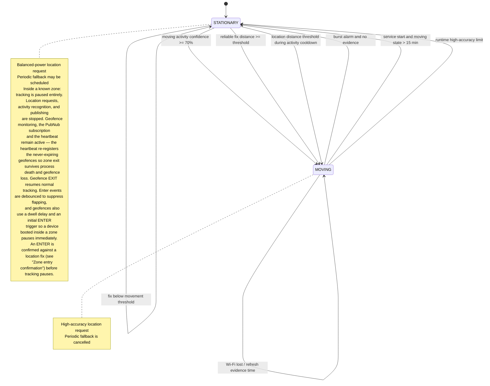

# Movement detection state diagram

The movement controller has two persisted states. Location updates, activity
recognition, Wi-Fi changes, and the burst-expiry alarm are the inputs. The
foreground service does not change the state machine; it owns delivery of
location callbacks while the coordinator applies these transitions.

## Transition details

### `STATIONARY` to `MOVING`

The coordinator switches to `MOVING` when it receives one of these signals:

- Activity recognition reports walking, running, cycling, on foot, or in a
  vehicle with at least 70% confidence.
- Consecutive location fixes with accuracy of 50 m or better accumulate at
  least the configured movement distance.

Fixes with worse accuracy are discarded before they reach the state machine
and can never switch the device into high-accuracy mode. Wi-Fi loss triggers
only a balanced one-shot verification fix; it no longer switches state
directly. The stationary scan defaults to a 2-minute interval with batched
delivery, similar to Home Assistant Companion's background cadence.

The high-accuracy request is then registered and the burst-expiry alarm is
scheduled.

### `MOVING` to `STATIONARY`

The coordinator returns to `STATIONARY` when the burst-expiry alarm fires and
no recent movement evidence exists. A moving state that has survived a
service restart for more than 15 minutes is also reset to stationary to avoid
leaving high-accuracy tracking active indefinitely.

During a running session, the same limit applies even when activity recognition
continually reports movement. Activity-only movement evidence is ignored during
the cooldown after that reset; a location fix crossing the configured distance
threshold can resume moving mode.

### Zone entry confirmation

A geofence ENTER (or DWELL) does not pause tracking by itself; it starts a
pending entry that must be confirmed by a location fix. This keeps a coarse
fix from briefly pausing tracking for a zone the device is not really in.

The arming gate uses the same zone-aware cap. If the event's triggering
location is coarser than that cap, the entry is ignored rather than armed: the
geofence engine fired on data it cannot reliably place, so there is no point
keeping a likely false positive pending. A null triggering fix (the engine
decided by other means), or one that is merely stale or outside the radius,
still arms.

The confirmation is background-capable and tries fixes in this order:

1. The geofence event's **triggering location**, confirmed immediately. This
   is the fix the geofence engine already used to decide the transition, so a
   usable fix pauses tracking without waiting for a background-frozen delay or
   a fresh one-shot.
2. If the triggering fix is not usable, a **one-shot** request after the entry
   hysteresis delay, allowed to answer with a recent cached fix.

A fix confirms the entry when it is not stale and its fix point is inside the
zone radius. Its accuracy is checked against a zone-aware cap — the normal
publish cap widened to the zone radius — so a coarse-but-plausible fix (for
example an indoor Wi-Fi fix) can confirm a large zone without waiting for
perfect GPS. On confirmation the entry fix is published and tracking pauses.

A single rejection does not drop the entry. A fix that is merely not usable
(stale, or outside the radius) leaves the entry pending, and each subsequent
location update re-evaluates it, so the entry is confirmed as soon as a usable
fix arrives. A missing zone clears it immediately. The pending entry is bounded
by a confirmation window (10 minutes): if no usable fix arrives within it, the
entry expires rather than lingering. The window is checked on each update and on
the heartbeat as a backstop.

### Registration rule

Location and activity registrations are idempotent. A callback must process
its fixes without re-registering either provider. Registration is only changed
when the movement state or request configuration changes, or when registration
health recovery is required.

If movement-state logic changes, update this diagram and its transition details
in the same change.
