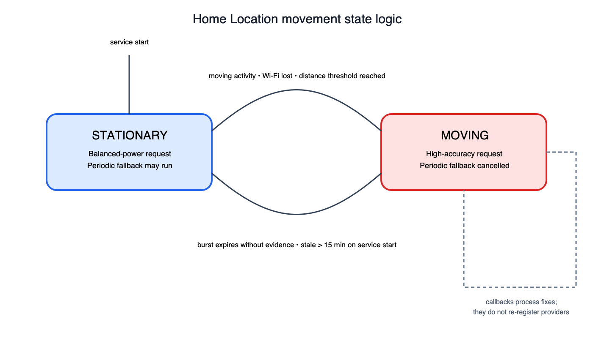
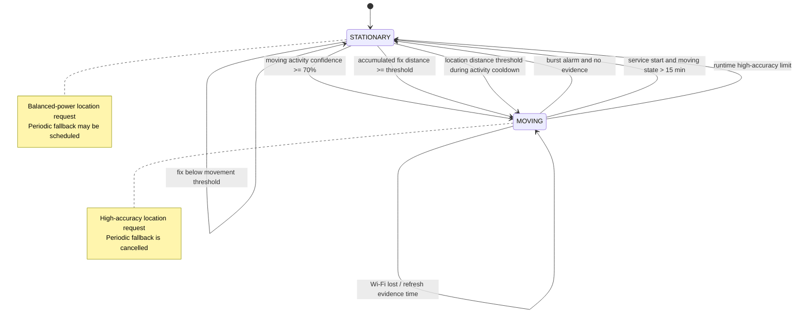

# Movement detection state diagram

The movement controller has two persisted states. Location updates, activity
recognition, Wi-Fi changes, and the burst-expiry alarm are the inputs. The
foreground service does not change the state machine; it owns delivery of
location callbacks while the coordinator applies these transitions.

## Transition details

### `STATIONARY` to `MOVING`

The coordinator switches to `MOVING` when it receives one of these signals:

- Activity recognition reports walking, running, cycling, on foot, or in a
  vehicle.
- The Wi-Fi network is lost.
- Consecutive location fixes accumulate at least the configured movement
  distance.

The high-accuracy request is then registered and the burst-expiry alarm is
scheduled.

### `MOVING` to `STATIONARY`

The coordinator returns to `STATIONARY` when the burst-expiry alarm fires and
no recent movement evidence exists. A moving state that has survived a
service restart for more than 15 minutes is also reset to stationary to avoid
leaving high-accuracy tracking active indefinitely.

During a running session, the same limit applies even when activity recognition
continually reports movement. Activity-only movement evidence is ignored during
the cooldown after that reset; a location fix crossing the configured distance
threshold can resume moving mode.

### Registration rule

Location and activity registrations are idempotent. A callback must process
its fixes without re-registering either provider. Registration is only changed
when the movement state or request configuration changes, or when registration
health recovery is required.

If movement-state logic changes, update this diagram and its transition details
in the same change.
