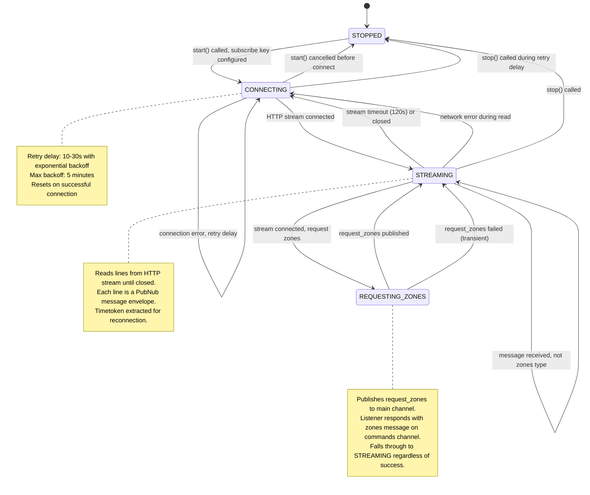

# ZonesSubscriber State Diagram

## State Transitions

### `STOPPED` → `CONNECTING`
- Triggered by `LocationCoordinator.start()` when geofencing is enabled
- Opens HTTP GET to `/subscribe/{key}/{channel}/{timetoken}/0`

### `CONNECTING` → `STREAMING`
- HTTP connection established successfully (200 OK)
- Begins reading lines from response body

### `CONNECTING` → `CONNECTING`
- Connection failed (DNS error, refused, timeout, 4xx/5xx response)
- Waits with exponential backoff (10s → 20s → 40s → ... → 5min max)
- Resets backoff counter on successful connection

### `STREAMING` → `REQUESTING_ZONES`
- On first successful connection, publishes `request_zones` to main channel
- On reconnection after a gap > 30s, re-requests zones to recover missed updates

### `STREAMING` → `STREAMING` (message)
- Line received from stream, parsed as `{"t":[{...}]}...`
- If `message.type == "zones"` and device name matches: forward to `ZoneManager`
- Extract timetoken for reconnection
- Ignore non-zones messages silently

### `STREAMING` → `CONNECTING`
- Stream closed normally (read timeout after 120s of inactivity)
- Network error during read (socket closed, interrupted)
- Parse error on a line (skip the line, continue reading)

### `STREAMING` → `STOPPED`
- `stop()` called from `LocationCoordinator.stop()`
- Cancels the coroutine, closes the HTTP response

### `REQUESTING_ZONES` → `STREAMING`
- `request_zones` published successfully, or failed (transient error)
- In both cases, continue listening for zones messages

## Error Handling

| Error | Handling |
|-------|----------|
| DNS resolution failure | Retry with backoff |
| Connection refused | Retry with backoff |
| HTTP 401/403 (auth error) | Log warning, retry with extended delay (2min) |
| HTTP 404 (channel not found) | Log warning, retry with extended delay |
| HTTP 5xx (server error) | Retry with backoff |
| Read timeout (120s) | Normal reconnection, no backoff increase |
| Socket closed during read | Retry with backoff |
| JSON parse error on line | Skip line, continue reading |
| `request_zones` publish fails | Log warning, continue to streaming state |
| Coroutine cancelled (`stop()`) | Clean shutdown, release HTTP resources |
